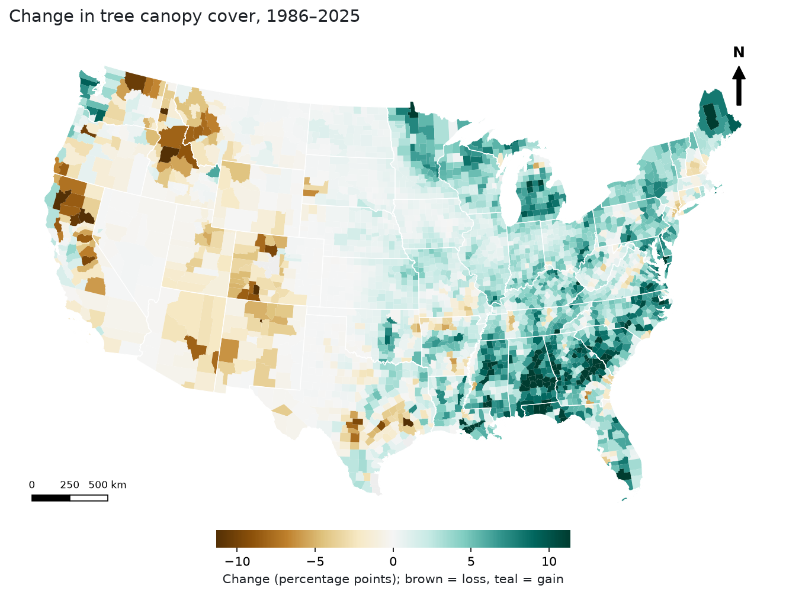
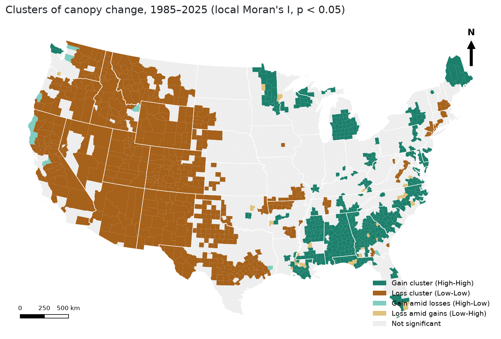
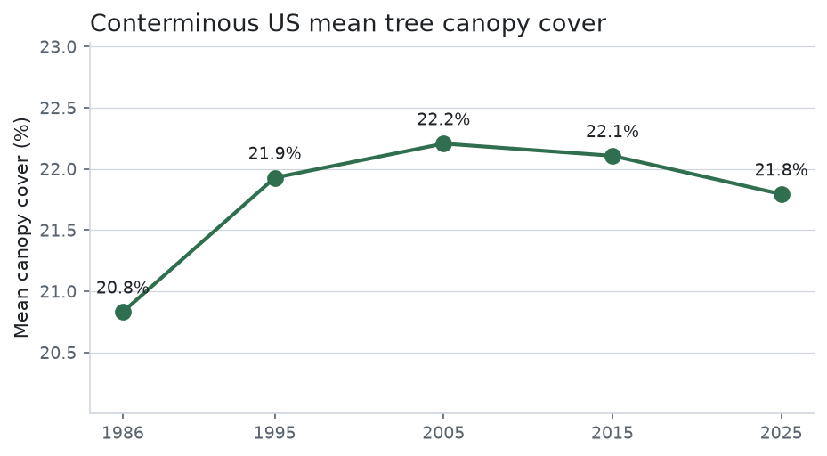
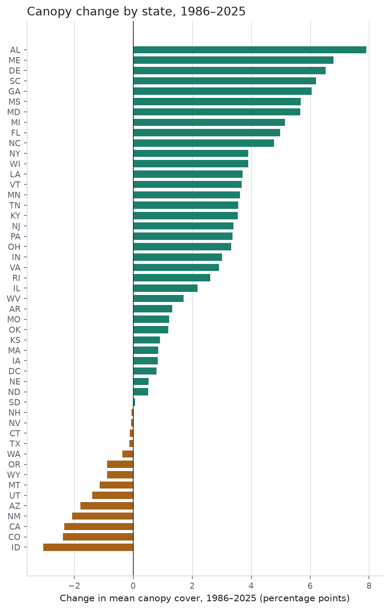
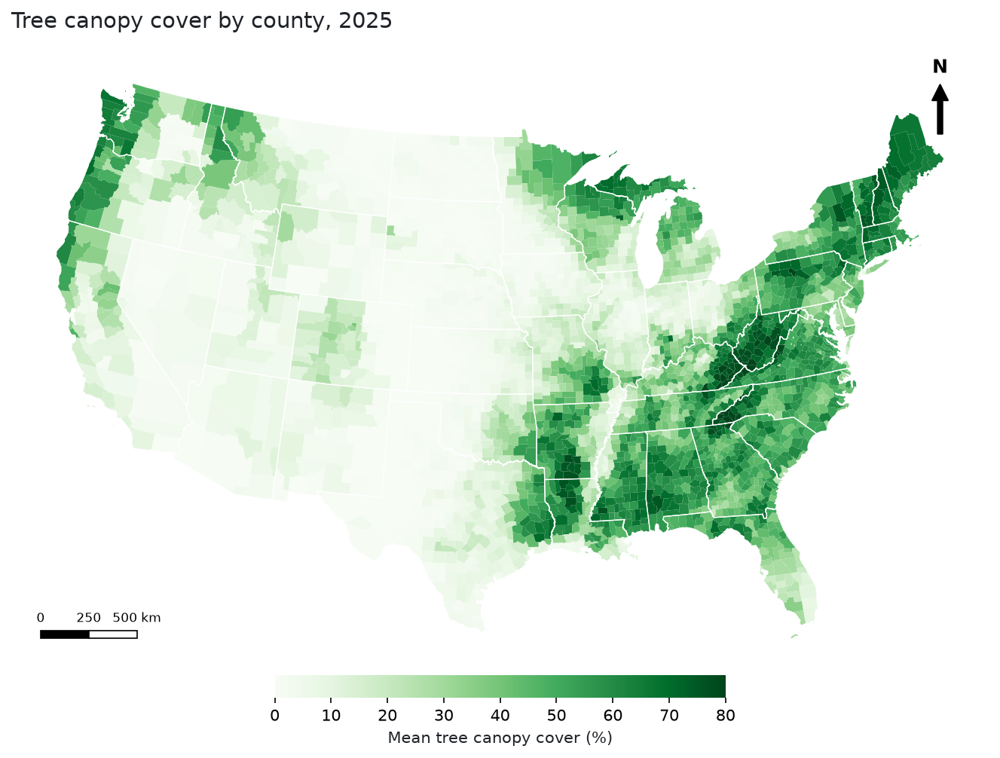
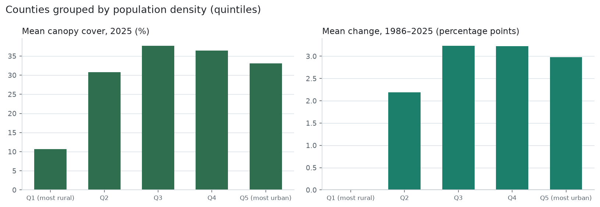

# Four decades of US tree canopy change, county by county

[](https://github.com/rajibhossain26/us-tree-canopy-change/actions/workflows/tests.yml)
[](https://github.com/rajibhossain26/us-tree-canopy-change/actions/workflows/zonal.yml)

How much tree canopy does each county in the conterminous US have, how has
that changed since the mid-1980s, and where are the losses and gains clustered? This
project answers that from the **USDA Forest Service / NLCD Tree Canopy Cover
(TCC) v2025.6** rasters — 30 m, wall-to-wall, about 15 billion pixels per year —
and links the results to population density and household income.

Everything is rebuilt by GitHub Actions from public data: the pipeline downloads
each year's raster (~3.6 GB), computes county means at full resolution, and
commits the tables and maps you see here.

**[Explore the interactive map →](https://rajibhossain26.github.io/us-tree-canopy-change/)** Every county, 1986–2025, with a time slider, county search and hover details.

## Key findings (1986–2025)

- **The US got slightly leafier overall, but not everywhere.** Mean canopy
  across the conterminous US rose from **20.8% to 21.8%** (+1.0 percentage
  point). It peaked around 2005 (22.2%) and has edged down since.
- **Four in five counties gained canopy** (2,485 of 3,094; median +1.7 pp).
  The biggest gains are in the Southeast's timber belt (Alabama +7.9 pp,
  South Carolina +6.2, Georgia +6.1, Mississippi +5.7) and in Maine (+6.8).
- **The West lost canopy.** The ten states with losses above 0.3 pp are
  all western: Idaho −3.1 pp, Colorado −2.4, California −2.3, New Mexico
  −2.1, Arizona −1.8, then Utah, Montana, Wyoming, Oregon and Washington. (Texas,
  Connecticut, Nevada and New Hampshire dipped by 0.1 pp or less.) Many of the steepest county losses are in
  places hit by large wildfires (Los Alamos NM −19.8 pp; Plumas CA −17.6; Trinity and Butte CA) or
  by rapid suburban growth (Montgomery County TX, north of Houston, −15.8).
- **Change is strongly clustered** (Moran's I = 0.69, p = 0.001): 531
  counties form clusters of above-average gain and 512 of below-average change;
  78% of the latter actually lost canopy.
- **Density and income are not the story at county scale.** Across all
  counties, denser counties have more canopy (ρ = +0.36), but within states
  the link turns slightly negative (r = −0.13), and income barely relates to
  change (within-state r = −0.06). Geography and climate dominate; urban
  canopy equity needs tract-level data (see
  [urban-heat-equity](https://github.com/rajibhossain26/urban-heat-equity)).

Full tables are in [`results/RESULTS.md`](results/RESULTS.md); county values
in [`results/county_canopy.csv`](results/county_canopy.csv).





| National trend | By state |
|---|---|
|  |  |





## Data

| Input | Source | Notes |
|---|---|---|
| Tree canopy cover, 1986, 1995, 2005, 2015, 2025 | [USDA Forest Service TCC v2025.6](https://data.fs.usda.gov/geodata/rastergateway/treecanopycover/) (NLCD product) | Percent canopy (0–100) per 30 m pixel, Albers Equal Area. The NLCD version masks water and non-tree agriculture and smooths year-to-year noise, which suits trend work. Codes 254/255 (background/no data) are skipped. |
| County boundaries | [Census 2023 cartographic boundary file, 1:500k](https://www.census.gov/geographies/mapping-files/time-series/geo/cartographic-boundary.html) | 3,100+ CONUS counties and equivalents (Connecticut planning regions). |
| Population, median household income | [ACS 2019–2023 5-year summary files](https://www2.census.gov/programs-surveys/acs/summary_file/2023/table-based-SF/), tables B01003 and B19013 | Plain text files; no API key needed. |

## Methods

1. **Zonal statistics at 30 m.** Each raster is read in 8,192 × 8,192 pixel
   tiles. For every tile the counties that overlap it are rasterized onto the
   tile's own grid (pixel-centre rule) and per-county sums are gathered with
   `np.bincount` (`src/canopy/zonal.py`). Because the raster is equal-area,
   the pixel mean is the area-weighted mean canopy for the county. Masked
   water is coded 0%, not no-data (valid pixels cover 100% of each county's
   land + water area), so the figure is canopy as a share of total area.
2. **Coverage check.** A county's valid-pixel count should be identical every
   year. The **1985** raster has scene gaps (7% of counties are under 99% of
   their usual coverage), so 1985 was computed but is left out and **1986**
   is the baseline; 15 other county-years with gaps are set to missing.
3. **Change** is the 2025 mean minus the 1986 mean, in percentage points (pp).
   National and state trends use the 3,094 counties with a value in every year,
   weighted by area.
4. **Spatial clustering.** Global Moran's I on county change with queen
   contiguity and 999 permutations, then local Moran's I (Anselin 1995) with
   conditional permutation to map clusters of loss and gain
   (`src/canopy/spatial.py`, plain numpy, unit-tested).
5. **Density and income.** Spearman correlations across counties, plus the
   correlation *within states* (each state's mean removed) to separate a real
   relationship from the East–West climate gradient that dominates canopy.

Maps use EPSG:5070 (CONUS Albers) with a north arrow and scale bar.

## Repository layout

```
src/canopy/zonal.py      tiled zonal statistics (bincount accumulator)
src/canopy/spatial.py    queen weights, global and local Moran's I
src/canopy/mapping.py    north arrow and scale bar
src/canopy/data.py       downloads: TCC rasters and Census county boundaries
src/canopy/acs.py        ACS population and income from Census summary files
scripts/zonal_stats.py   one year of TCC -> data/zonal/tcc_<year>.csv
scripts/run_analysis.py  tables, maps and results/RESULTS.md
scripts/export_web.py    simplified county map data for the interactive page (docs/index.html)
.github/workflows/       tests, the full raster pipeline, and a quick re-run of the analysis
```

## Run it yourself

```bash
pip install -r requirements.txt
curl -fLo tcc_2025.zip https://data.fs.usda.gov/geodata/rastergateway/treecanopycover/docs/v2025-6/nlcd_tcc_conus_2025_v2025-6_wgs84.zip
python scripts/zonal_stats.py --year 2025 --zip tcc_2025.zip
# ...repeat for at least one more year, then:
python scripts/run_analysis.py
pytest -q
```

Each year needs ~8 GB of free disk (zip plus extracted GeoTIFF) and runs in
well under an hour on a laptop.

## Caveats

- TCC is a **model** (random forests on Landsat and Sentinel-2 imagery); its
  per-pixel error is substantial, though county averages over millions of
  pixels are far more stable. Small changes (under ~1 pp) should be read as
  "no clear change".
- Canopy here includes forests, orchards and street trees alike; a county can
  gain canopy from plantation forestry while losing urban trees.
- County means hide big within-county differences; this is a screening-level
  national picture, not a neighbourhood equity analysis.
- The correlations are descriptive, not causal.

## Citation

USDA Forest Service. 2026. *Tree Canopy Cover, v2025.6*. Salt Lake City, UT.
https://data.fs.usda.gov/geodata/rastergateway/treecanopycover/

---
Author: [Rajib Hossain](https://rajibhossain26.github.io) · MIT License
